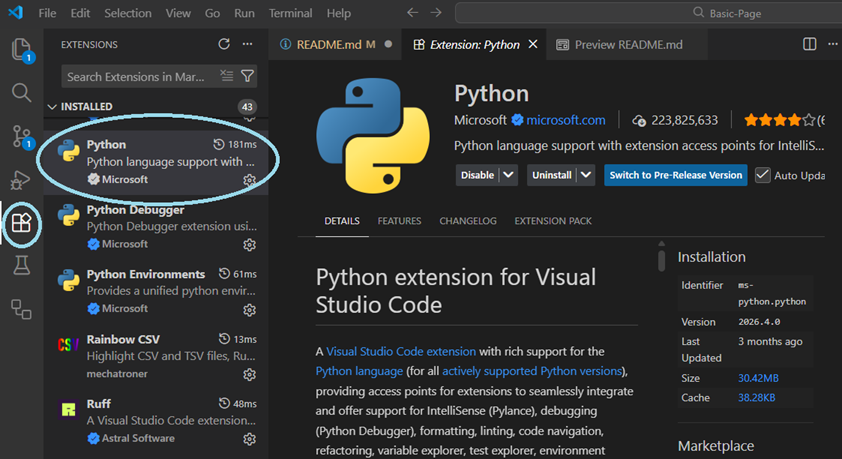
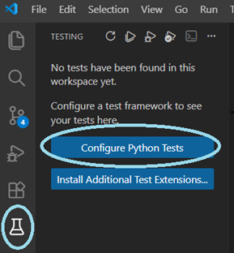
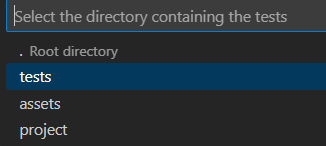

# Basic Page Project

## Learning Target: 
Students will be generate a **one pager** web project devoted to a topic of choice (a business, historical event or person, how to instructional page, travel destination, or something similar). This page will apply a variety of common HTML elements and apply basic CSS techniques to apply fonts and colors.

:joy:
---------
[top](#basic-page-project) | [learning target](#learning-target) | [instructions](#instructions) | [project requirements](#project-requirements) | [grading](#grading)

## Instructions:
Once you have accepted the assignment and have a copy of your repo...

### Project Setup

<b><i>* Testing Setup</i></b>

***NOTE**: this step is only necessary if you want to check to make sure you've met all your `HTML` and `CSS` requirements.*

* Open the Software Center and make sure the following apps are installed in the following order...
    - Python
    - Python Poetry
    - Python pip-system-certs
* Open your project in VSCode.
* Make sure that the Python Extension from Microsoft is installed
    
* Open the terminal (Terminal > New Terminal)
* Type: `poetry env activate`
* Type: `poetry update`
* Open the Command Palette
    - Click on the View Menu then select Command Palette
    
    *OR*
    - Type `CTRL` + `Shift` + `P`
* In the Command Palette...
    - Type: "Python: Select Interpreter"
    - Select the one that states basic-page and shows "poetry" on the side.
    

<b><i>* Testing your project using pytest</i></b>

***NOTE**: this too is only necessary to test your project to see if you meet all `HTML` and `CSS` coding requirements.

1. Click the Test Icon (a flask) and choose "Configure Python Tests"

    
2. Select the "pytest" test option

    
3. Select the tests folder

    
4. Click the run test icon

    
5. NOTE: you will fail tests until you begin coding and meeting requirements.

### Working on Your Project 

<b>Adding your Web Content</b>

1. Open your project in VSCode.
2. Create a file named `index.html` in the project folder.
3. Add the basic HTML code to `index.html`
4. Select a topic to explore where you have access to content (you do not have to write your own content).
    - choose a topic that you can break up into at least three sub-categories.
    - I recommend a favorite topic of yours that you are interested in or pick a unit of study that you have for another class.
5. In the body of `index.html` add the headers you plan to use.
    - Add a title using the most important heading tag.
    - In the `head` section, be sure to provide the same title in the `<title>` tag.
    - Add a sub-title (using the appropriate heading tag) to title each of your sections.
6. In each section add several paragraphs.
    - Each paragraph should be short and scannable.
    - One concise thought per paragraph.
    - No more than 4 sentences per paragraph.
    - Try including several singl-sentence paragraphs.
    - Do NOT use ` ` tags to "create" paragraphs (instead surround each paragraph with a '
' tag).

<b>Styling Your Page</b>

1. Add CSS using a `<style>` tag in the head or an external stylesheet; do not use style attributes in HTML.
2. Apply a readable font or font pairing other than Times New Roman or Comic Sans.
3. Apply a background color and text color to the `body` or `html`, and set colors for both regular and visited hyperlinks.
4. Make sure all colors meet WCAG AAA contrast goals using the [WebAIM Contrast Checker](https://webaim.org/resources/contrastchecker/).
5. Add padding to any layout elements you use, such as `header`, `nav`, `main`, `article`, `aside`, `hgroup`, `section`, or `footer`.

### Tracking Your Project History

<b>Using Git</b>

* As you work on your page, be sure to commit and push your changes using the following commands:
    - `git add *`
    - `git commit -m "concise explanation of what you did"`
    - `git push origin main`
* When you push a commit, the **Autograding Tests** GitHub Actions workflow runs the pytest suite.
* The workflow shows a green check when all tests pass. Its run summary lists passed, failed, and skipped tests per test file, includes details for failing tests, and gives a final score out of 4: 4/4 for all tests passing; 3/4 when all tests in files with `proficiency` in their names pass; 2/4 when at least half of all tests pass; otherwise 1/4.
* To turn in your assignment, take a screen capture of the final product as seen on a browser and turn that in.
    - Your teacher can see if you passed all tests
    - You will then receive a grade based on the scoring categories (see [scoring categories](#scoring-categories))

---------
[top](#basic-page-project) | [learning target](#learning-target) | [instructions](#instructions) | [project requirements](#project-requirements) | [grading](#grading)

## Project Requirements:
NOTE: 
* this is a list of requirements for the project itself
* You will also be scored on **project management** and **professionalism**

<b>HTML Requirements</b>

**Automated HTML requirements**
* Your web page must be named `index.html`
* Your page should include all standard tags that should be present in any `HTML` document (one `DOCSTRING` one `html` one `head` one `title` one `body`, and one `h1`)
* Must ***use appropriate headers*** according to semantic reasoning
* Must have at least ***two sections*** each labeled ***with an appropriate header***.
    - should be level 2 headings.
    - sub headings (level 3) are allowed, but only if you are breaking up a section into sub-sections 
* Must have at least five paragraphs per page (try to distribute them across sections).
* Must have at least two lists (`ul` or `ol`) per page and at least seven `li` elements in all.
* Must include at least two links, inside a list item or paragraph.
* Must pass HTML Validation (test your page using the [w3c validator](https://validator.w3.org/))

<b>CSS Requirements</b>
 

**Automated CSS requirements**
* Must ***use CSS*** as a style tag or external stylesheet to add styles.
    - ***You may NOT use the style attribute***
* Apply a readable font or font pairing other than Times New Roman or Comic Sans.
* Apply a background color and text color to the `body` or `html`, and set colors for both regular and visited hyperlinks.
* Make sure all colors meet WCAG AAA contrast goals.
* Add padding to any layout elements you use, such as `header`, `nav`, `main`, `article`, `aside`, `hgroup`, `section`, or `footer`.
* Do not use style attributes in HTML; use a `<style>` tag in the head or an external stylesheet.

 

The **design** score, however, will be scored by your teacher

<b>Design Requirements</b>

* Above all, ***text must be readable*** (both through the font-face as well as in the use of high contrast colors)
* Use of fonts (no more than 2) and colors match the content of the site.
* All paragraphs of text are broken up into smaller chunks of text and  left-aligned or justified (NOT centered).
* The only text that may be centered is the headings (`h1` and/or `h2`)
* Typography follows most guidelines of the [Practical Typography Summary of Key Rules](https://practicaltypography.com/summary-of-key-rules.html) especially font size, line spacing, and line length.
* Layout is balanced without any irregular gaps that call attention to themselves. Any images should be floated so the text wraps around it.

<b>Project Management Requirements</b>

* You create a **public** GitHub repo using this template
* You follow instructions (listed here)
* You commit your work on a regular basis using commit messages that are...
    - concise (brief and to the point)
    - descriptive of the changes
    - consistently formatted (in grammar structure)
* You use git push (not by file upload)
* You turn in both...
    - a link to your GitHub repo

-------

[top](#basic-page-project) | [learning target](#learning-target) | [instructions](#instructions) | [project requirements](#project-requirements) | [grading](#grading)

## Grading
Your project will receive a score based on the final criteria:
### For Proficient (3/4)

<b>Develop static websites</b>...
 

by structuring content with HTML and formatting it using CSS to create well-organized and visually appealing web pages.

* The automated score is reported by the **Autograding Tests** workflow after each push.
* Passing every test in files with `proficiency` in their names earns 3/4, unless all tests pass, which earns 4/4.
* See the scoring rules in [Tracking Your Project History](#tracking-your-project-history) for the other score levels.

<b>Apply the design principles</b>...

of color, typography, balance, space, and visual hierarchy to **create visually appealing and user-friendly web pages**.

These tests will be measured by your instructor using the [design requirements guidelines](#design-requirements) above

    

<b>Apply project management skills</b>...

and use industry-standard tools** to plan, track, and complete development projects effectively.
* Uses Git to track work with multiple commits
* Commit messages are generally descriptive and related to the code changes
* Follows basic expectations (does not rely on file upload, commits reflect work progress)

<b>Demonstrate professionalism and employability skills</b> relevant to computer science careers.

* Turned project in on time and followed submission requirements (***self-awareness***)
* Content is appropriate for a school/professional audience (**self-awareness** / **resilience**)
* Uses clear and appropriate naming and structure (for example: index.html, meaningful link text and headings) (**digital literacy**/ **communication**)
* No major grammar/spelling errors; text and links clearly communicate purpose to a user (**communication**)

### For the Win (4/4)
The automated score is 4/4 when all tests pass. Use the requirements in this README and the more specific checklist in [`project/README.md`](project/README.md) to guide your work.

<b>Develop Static Websites...</b>

Follow the HTML and CSS requirements above. All required element counts and styling criteria are listed in [`project/README.md`](project/README.md); the automated score is based on test results, not additional section, paragraph, or line-break counts.

<b>Apply Design Principles...</b>

* Make sure the colors are from a color palette and they look good.
* Make sure the colors meet color contrast (see above).
* Make sure text is readable, and the fonts do not compete with the theme of the content.
* Make sure text is readable, and the paragraphs are not too wide.
* Make sure paragraphs are not centered text

<b>Apply Project Management Skills</b>

* Uses Git consistently throughout development with purposeful, well-timed commits
* Commit messages are clear, concise, and follow a consistent naming convention
* Commits accurately reflect meaningful changes and demonstrate an organized workflow

<b>Demonstrate Professionalism and employability skills</b>

* Turned project in on time and fully met all requirements without reminders (self-awareness)
* Content is consistently appropriate, purposeful, and demonstrates awareness of a real-world audience (self-awareness)
* Naming and structure are consistently clear and intentional, reflecting strong use of basic development conventions (digital literacy / communication)
* Writing is polished, clear, and free of errors, making the page easy to understand and navigate (communication)

[top](#basic-page-project) | [learning target](#learning-target) | [instructions](#instructions) | [project requirements](#project-requirements) | [grading](#grading)
